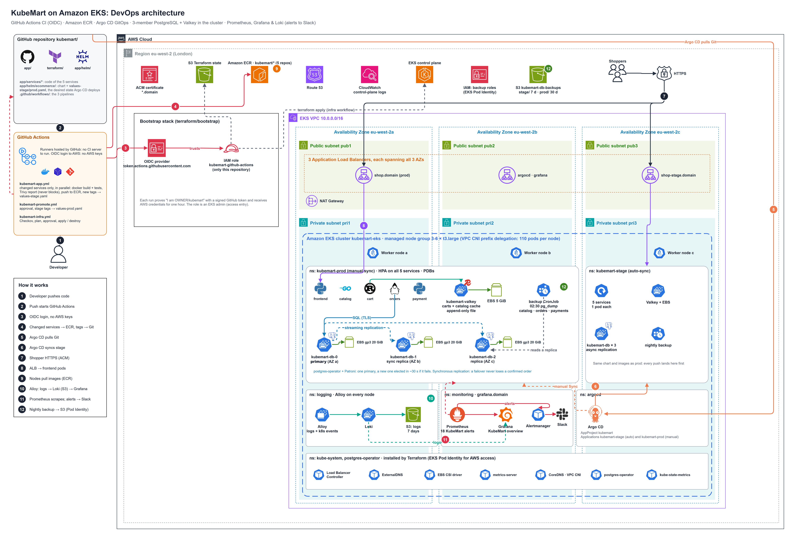

# KubeMart on Amazon EKS

A complete, self-contained project: a **polyglot e-commerce shop** (Python, Go, Rust, Java), its **self-managed data stores** (3-member PostgreSQL + Valkey), the **Terraform** for its AWS platform, and the **GitHub Actions** pipelines that build it, with **Argo CD** deploying from Git.

This folder is designed to be its **own GitHub repository**: GitHub only runs workflows from `.github/workflows/` at the root of a repository, and every path in the workflows and Argo CD is relative to this folder.



## What is inside

```text
kubemart/                              <- repository root
├── app/                               the shop
│   ├── services/                      frontend (Python) · product-catalog (Go) · cart (Rust)
│   │                                  orders (Java) · payment (Python)
│   ├── helm/ecommerce/                one chart: services, PostgreSQL cluster, Valkey, backups,
│   │                                  ServiceMonitors, 18 alerts, Grafana dashboard
│   ├── argocd/                        AppProject + Applications (Terraform creates the same)
│   └── docker-compose.yml             the whole shop + PostgreSQL + Valkey on your laptop
├── terraform/                         VPC, EKS, ECR, add-ons, Prometheus/Grafana, Loki (logs in S3),
│   └── bootstrap/                     postgres-operator, namespaces, backup bucket, Argo CD
│                                      (bootstrap: GitHub OIDC role + wildcard certificate)
├── .github/workflows/
│   ├── kubemart-infra.yml             Terraform: Checkov, plan, approval, apply / destroy
│   ├── kubemart-app.yml               changed services only: build + test, Trivy, ECR, tags -> stage
│   └── kubemart-promote.yml           approval, then stage tags -> prod (Argo CD Sync)
├── architecture/                      4 draw.io diagrams (.png to view, .drawio to edit)
└── docs/
    ├── KubeMart-App-Guide.docx        services, data layer, monitoring, chart, pipelines
    └── KubeMart-EKS-Deployment-Guide.docx   step-by-step deployment, costs, teardown, troubleshooting
```

| Part | Highlights |
|---|---|
| Application | 5 services in 4 languages, no data in memory, HPA on all five in prod |
| Data | PostgreSQL 17 run by the **postgres-operator**: 3 members in 3 zones, automatic failover, synchronous replication in prod, one database per service; Valkey for carts and the catalog cache; nightly `pg_dump` to S3 |
| Correctness | stock reserved in one SQL statement (never oversold), one payment per order, order saved before charging |
| Delivery | GitHub OIDC (no AWS keys), only changed services rebuilt, Trivy vulnerability report on every image, GitOps commit to stage, approval + Argo CD Sync for prod |
| Observability | Prometheus + Grafana + Loki: metrics, 18 alerts (to Slack through Alertmanager), and every container log and Kubernetes event in the same Grafana. Logs are kept in S3 |

## Diagrams

| Diagram | What it shows |
|---|---|
| [`kubemart-devops-architecture`](architecture/kubemart-devops-architecture.png) | GitHub Actions, AWS services, the VPC across 3 AZs, the EKS cluster with stage, prod (services, PostgreSQL, Valkey), Argo CD, monitoring and logging, and the backup bucket |
| [`kubemart-system-architecture`](architecture/kubemart-system-architecture.png) | The platform as layers: users, edge, application, data, GitOps, observability |
| [`kubemart-checkout-data-flow`](architecture/kubemart-checkout-data-flow.png) | One checkout, service by service and store by store |
| [`kubemart-cicd-gitops-pipeline`](architecture/kubemart-cicd-gitops-pipeline.png) | From `git push` to production |

## Quick start

```bash
# 0. push this folder as its own repository
cd kubemart
git init && git add . && git commit -m "KubeMart on EKS"
git branch -M main
git remote add origin https://github.com/<you>/kubemart.git
git push -u origin main

# 1. change the state bucket name, domain, github_repository, git_repo_url and admin ARN
cd terraform && ./create-remote-state.sh      # prints the role ARN for GitHub

# 2. in GitHub: secret AWS_ROLE_ARN, variable DOMAIN_NAME,
#    environments "infrastructure" and "production" (required reviewers), "stage" (none)

# 3. Actions: "KubeMart Infrastructure" (apply), then "KubeMart Application" (Run workflow)
```

Run the shop on your laptop: `cd app && docker compose up --build`, then open <http://localhost:8080>.

The full walkthrough is in [`docs/KubeMart-EKS-Deployment-Guide.docx`](docs/KubeMart-EKS-Deployment-Guide.docx).

> Running the platform costs roughly USD 14 per day. Destroy it after each study session (workflow action `destroy`, then `terraform/destroy-remote-state.sh`).
